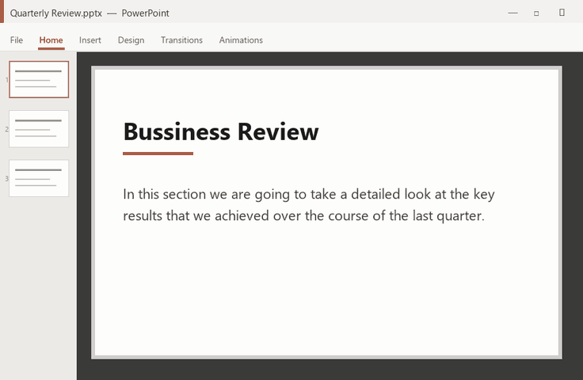

# Claude Overlay

<p align="center">
  <a href="https://docs.claude.com/en/docs/claude-code"></a>
  
  
  <a href="LICENSE"></a>
  <a href="https://github.com/shengyanlin/claude-overlay/stargazers"></a>
  <a href="https://github.com/hesreallyhim/awesome-claude-code"></a>
</p>

> ### Talk to Claude Code without ever leaving the app you're in — and let it actually *see* your screen.

<p align="center"><sub><b>Windows 10 / 11</b> and <b>macOS</b> · runs on your existing Claude subscription — no API key</sub></p>

https://github.com/user-attachments/assets/f47fb39d-68f5-42ba-b2be-5442812838d8

**Claude Overlay** is a small always-on-top chat window that floats over whatever you're
doing. Ask a question and Claude looks at your **real screen** to answer — no copy-pasting
error messages, no describing what you're staring at, no alt-tabbing. It runs the full
[**Claude Code**](https://docs.claude.com/en/docs/claude-code) agent, so it can also
*act*: edit the slide, document or spreadsheet you have open, change files, run commands.

It drives **your own** `claude` CLI login, so it uses your existing Claude subscription:
**no API key and nothing extra to pay.**

> ⭐ **If a screen-aware Claude that floats over your work sounds useful, star the repo** — it helps other people find it.

## What it does

- 👁️ **Sees what you see.** Every message carries a fresh screenshot of each monitor (or
  only the active window, if you prefer). Just ask *"what's wrong here?"*
- ✍️ **Acts on what's open.** Ask it to fix the typo on the current slide or build a model
  in the open spreadsheet. No file path needed.
- 🪟 **Stays out of your way.** Frameless and always on top; collapses to a small orb, and
  shows a ✓ on it when a reply finishes.
- 🔀 **Claude or Codex.** One switch in the title bar puts OpenAI's Codex behind the same
  window, on your own `codex` login.
- 🖼️ **Images and files.** Paste an image, or attach a PDF, Word or PowerPoint file.
- 🔁 **Conversations survive restarts.** Reopen it and resume where you left off.
- 🏷️ **Run several at once.** Name each overlay for the task it's on.

<p align="center">
  
  <br><em>Ask it to fix the open slide — it edits the deck you already have open.</em>
</p>

More examples: **[what a floating overlay is good for](docs/use-cases.md)**.

## Install

You need a Claude subscription. The setup script installs everything else it finds
missing: Python, the `claude` CLI, and (optionally) the `codex` CLI.

**1. Get the folder**

```
git clone https://github.com/shengyanlin/claude-overlay.git
```

(or download the ZIP from the green **Code** button and unzip it)

**2. Set it up and start it**

| | Windows | macOS |
|---|---|---|
| Set up (once) | double-click **`setup.cmd`** | double-click **`setup.command`** |
| Start | double-click **`Start Claude Overlay.cmd`** | double-click **`Claude Overlay.app`** |
| First launch | — | allow **Screen Recording** when macOS asks, then start it again |

That's it: type a question and press **Enter**.

Full walkthroughs, installing by hand, and locked-down work laptops:
**[Windows guide](docs/windows.md)** · **[macOS guide](docs/macos.md)**

## Use

| To | Do this |
|---|---|
| Send a message | `Enter` (`Shift+Enter` for a new line) |
| Show or hide the overlay from anywhere | `Ctrl+Alt+Space` on Windows, `⌥⇧Space` on a Mac |
| Stop a reply | `Esc`, or the **■** button |
| Collapse to the orb / expand again | **–** / click the orb |
| Turn the automatic screenshot on or off | **◉ Auto-shot** |
| Paste an image | `Ctrl+V` (`⌘V` on a Mac) |
| Attach a file, capture only the active window, go read-only | the **⚙** menu |
| Switch model, or how hard it thinks | click the status line at the bottom |
| Switch between Claude and Codex | the **Claude \| Codex** switch in the title bar |
| Start a new conversation | **Clear** |
| Move / resize | drag the title bar / drag any edge |

Everything else: **[all controls](docs/controls.md)**.

## Update

Installed with `git clone`? The overlay updates itself when you open it. To update by
hand, double-click **`update.cmd`** (Windows) or **`update.command`** (macOS).
Details: **[updating](docs/updating.md)**.

## Settings

Put the settings you want to change in a small `config.json`, which survives updates:

| Windows | macOS |
|---|---|
| `%LOCALAPPDATA%\claude-overlay\config.json` | `~/Library/Application Support/claude-overlay/config.json` |

```json
{
  "PERMISSION_MODE": "plan",
  "THEME": "dark"
}
```

Every setting and what it does: **[configuration](docs/configuration.md)**.

## Something not working?

Double-click **`Diagnose.cmd`** (Windows) or **`Diagnose.command`** (macOS). It checks the
install and copies a report to your clipboard, ready to paste into an issue.
Common problems and fixes: **[troubleshooting](docs/troubleshooting.md)**.

## ⚠️ Security note

By default the overlay runs Claude with `PERMISSION_MODE = "bypassPermissions"`: a **fully
autonomous agent** that can edit files and run commands **without asking**, and that can
see your screen. That is what lets it change the document you have open, and it also
means it can change things you didn't intend.

- To make it look and answer but change nothing, turn on **⚙ → Read-only**.
- To start that way every time, set `"PERMISSION_MODE": "plan"` in `config.json`.

Read the full note, including what the overlay reads from your stored login, before
relying on it: **[permissions and security](docs/security-note.md)**.

## Privacy

Claude Overlay reports anonymous usage counts: one request per launch carrying the
version, a random per-install id, the OS build and the Python version, and nothing else.
Nothing you type, nothing the model says and no part of your screen is in it. **It is on
in this release, and it is opt-out**: set `DO_NOT_TRACK=1` or `CLAUDE_OVERLAY_TELEMETRY=0`
to turn it off. Full details: [PRIVACY.md](PRIVACY.md).

## How it works

```
Overlay (Tkinter UI)  →  claude-agent-sdk  →  your `claude` CLI  →  Anthropic
        ▲ screenshots (Pillow ImageGrab, one image per monitor)
```

The overlay is not an API client. It starts the `claude` CLI you already have installed
and talks to it, which is why your subscription and login are the ones used. The same
code runs on both systems; only the layer that talks to the operating system differs
(`win32utils.py` on Windows, `macutils.py` on macOS).

## Contributing

Issues and PRs are welcome — bug reports, feature ideas, and especially a **Linux** port.
See [CONTRIBUTING.md](CONTRIBUTING.md).

## License

[MIT](LICENSE) © shengyanlin

---

<p align="center">
  <sub>Built with Claude Code. If it earned a spot on your screen, leave a ⭐ — it genuinely helps.</sub>
</p>
