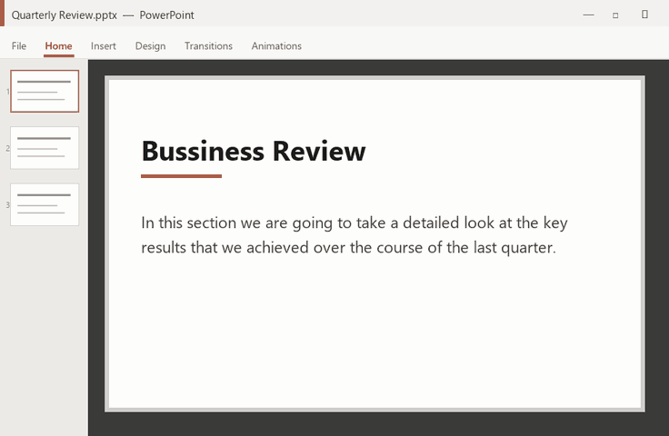
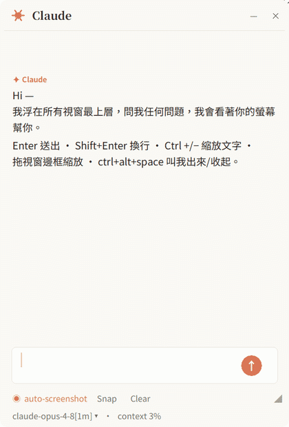

# Where a floating overlay wins

[← Back to the README](../README.md)

The CLI and the desktop app are perfect when you're already in a terminal or a chat
window. The overlay earns its place by floating over **whatever you're doing**, **seeing
it**, and **acting on it** — so it shines exactly where those can't:

- ✍️ **Edit what's right in front of you.** Don't just ask *about* the open
  document — ask it to *change* it. Fix a typo on the current slide, tighten a
  paragraph in your draft, fill a cell, or reword a heading. Because it's a full
  Claude Code agent with a shell, it can drive the app you already have open (PowerShell/COM
  automation on Windows, AppleScript on a Mac) to edit the file you're looking at — **no file
  path needed**. It works this out at run time rather than from a built-in
  integration, so it's not infallible: sanity-check important documents first
  (see the [security note](security-note.md)).

  
   <em>Ask it to fix the open slide — it edits the deck you already have open, no file path given.</em>

- 📊 **Build, not just edit.** Ask for a spreadsheet and it builds the real thing in your
  open Excel — sourced assumptions, live formulas, a top-down calculation, even a
  low/base/high sensitivity, laid out like a banker's model. One sentence in the overlay,
  a working model in the sheet.

  
   <em>Ask in the overlay; it drives Excel to build the model — assumptions, formulas, and a sensitivity.</em>

- 🖥️ **Mid-presentation.** Stay in full-screen slideshow. Summon the overlay to
  fact-check a number, translate a term, or field an audience question on the spot —
  then dismiss it without ever leaving the deck.
- 🌐 **Reading in another language.** On a foreign-language page, PDF, or slide, ask
  it to translate or explain what's on screen, *in place* — no copy-pasting into a
  separate translator tab.
- 📄 **Skimming something long.** "TL;DR this", "what does it say about X?" — about the
  article, whitepaper, or PDF you're looking at, without selecting or pasting a word.
- 🧩 **Any GUI with no terminal.** A cryptic error dialog, a settings panel, a BI
  dashboard, a spreadsheet formula — point your screen at it and ask. It works over
  apps that have no command line and nothing to copy.
- 🖥️🖥️ **Across monitors.** It captures every screen, so ask it to reconcile the spec
  on one monitor against the figure or table on the other.
- 🎥 **On a call or screen-share.** A discreet, always-on-top helper to look things up
  about what's being shown — without alt-tabbing away from the meeting.

  
   <em>Not using it? It collapses to an orb that floats out of the way — click to bring it back.</em>

